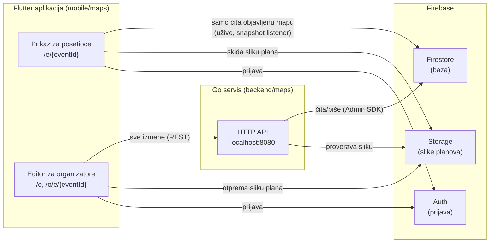
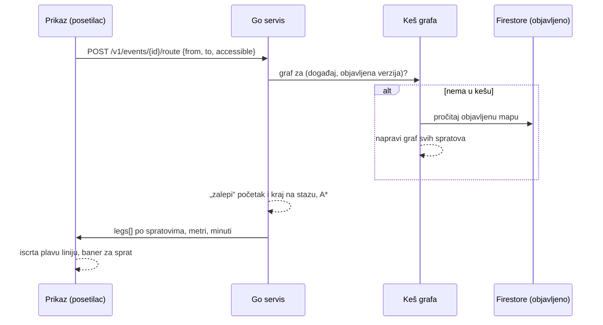

# Mapa prostora: kako sve radi

Objašnjenje za ljude (na srpskom). Tačan ugovor je u [`openapi.yaml`](openapi.yaml) i [`realtime.md`](realtime.md), plan i status faza su u [`PLAN.md`](PLAN.md).

## 1. Šta mapa radi, u jednoj rečenici

Organizator otpremi sliku plana prostora i na njoj nacrta sale, štandove, mesta (toalet, info pult…), QR markere „Vi ste ovde“ i staze. Kada klikne **Objavi**, posetioci koji imaju otvoren link odmah vide novu mapu, mogu da pretražuju, dobiju put do štanda i vide gde su (GPS tačka).

## 2. Tri dela i ko šta radi



| Deo | Folder | Zadatak |
| --- | --- | --- |
| Flutter paket `eho_maps` | `mobile/maps/` | Prikaz za posetioce i editor za organizatore. Aplikacija (`mobile/app/`, Ilij4n) ga samo uključi preko `mapsRoutes()`. |
| Go servis | `backend/maps/` | Jedini koji **piše** u bazu: proverava ko je korisnik, validira podatke, objavljuje mapu. |
| Ugovor | `contracts/maps/` | Dogovor između aplikacije i servisa: koji endpointi postoje i kako izgledaju podaci. |
| Firebase | (emulatori lokalno) | Auth = prijava, Firestore = baza, Storage = slike planova. |

**Zlatno pravilo:** aplikacija nikad ne piše direktno u bazu. Sve izmene idu kroz Go API, a Firestore pravila (`backend/maps/firebase/firestore.rules`) zabranjuju upis iz aplikacije. Čitanje objavljene mape ide direktno iz Firestore-a jer je tako „uživo“ besplatno.

## 3. Podaci: šta je šta

Sve koordinate su **pikseli slike plana** (x udesno, y nadole). Zato mapa radi i bez GPS-a.

| Pojam | Šta je |
| --- | --- |
| **Događaj** (`Event`) | Naziv, datumi, vlasnik (organizator) i `publishedVersion` (0 = nikad objavljeno). |
| **Sprat** (`Floor`) | Jedna slika plana (širina, visina u pikselima). Opciono i 3 kontrolne tačke koje povezuju piksele sa GPS koordinatama (§10). |
| **Objekat** (`Feature`) | `room` (sala: pravougaonik ili mnogougao), `stand` (štand: tačka ili pravougaonik), `poi` (mesto: ulaz, toalet, info, garderoba, hrana, lift, stepenice), `marker` (QR „Vi ste ovde“). Ima naziv, opis, a štand i kompaniju, kategoriju, sponzorstvo. |
| **Staza** (`Graph`) | Po spratu: **čvorovi** (tačke na hodnicima) i **veze** između njih. Po tome se računa put. Čvorovi sa istim `connector` ključem na različitim spratovima su lift ili stepenice. |
| **Ulaz za rutu** (`entranceNodeId`) | Čvor staze na kome se put do objekta završava (ili, kod QR markera, počinje). Editor ga sam postavi na najbliži čvor. |

### Nacrt i objavljeno

U bazi postoje **dve kopije** mape svakog događaja:

```
events/{eventId}                         ← događaj (naziv, vlasnik, publishedVersion)
events/{eventId}/draft/map/...           ← NACRT: ovo menja organizator, vidi samo on
events/{eventId}/published/map/...       ← OBJAVLJENO: ovo vide posetioci
        ├── floors/{floorId}
        ├── features/{featureId}
        └── graphs/{floorId}
```

Organizator menja samo nacrt. **Objavi** u jednoj transakciji proveri ceo nacrt, prepiše ga u „objavljeno“ i poveća verziju. Posetioci zato nikad ne vide polovičnu izmenu.

## 4. Prijava i ko sme šta

- **Posetilac** se prijavi anonimno, automatski i bez forme. Sme da čita samo objavljene događaje.
- **Organizator** se prijavi email/lozinkom. Sme da menja samo **svoje** događaje: servis to proverava na svakom zahtevu (`ownerUid`).
- Aplikacija šalje Firebase token u zaglavlju `Authorization: Bearer …`. Servis ga proverava (`internal/httpapi/middleware_auth.go`).
- Slike planova u Storage-u: otprema samo vlasnik (najviše 10 MB, PNG/JPEG), a čita svako prijavljen kada je događaj objavljen (`firebase/storage.rules`).

## 5. Tok: organizator pravi mapu

1. `/o`: prijava, pa lista „Moji događaji“, pa **Novi događaj** (`POST /v1/events`).
2. `/o/e/{id}`: editor učita nacrt (`GET /v1/events/{id}` + `GET …/draft`).
3. **Dodaj sprat:** slika ide direktno u Storage (`events/{id}/floors/…`), zatim `POST …/floors`. Servis proveri da slika postoji i pročita joj dimenzije.
4. **Crtanje:**
   - sala, štand, mesto, QR marker: nacrtaš oblik, popuniš formu, pa `POST …/features` (izmena `PATCH`, brisanje `DELETE`);
   - staza: klikovi dodaju i povezuju čvorove. Editor ih skupi i 0,4 s posle poslednjeg klika pošalje ceo graf sprata jednim `PUT …/graph`.
5. **Objavi** (`POST …/publish`). Servis proverava:
   - **greške** (blokiraju objavu): nema spratova, neispravan oblik, ulaz pokazuje na obrisan čvor…;
   - **upozorenja** (ne blokiraju): objekat nije povezan sa stazom ili je na odsečenom delu staze.

   Editor ih prikaže na srpskom, a klik na stavku otvori taj objekat.

Svaki zahtev servis validira (`internal/venue/validate.go`): oblici moraju biti unutar slike, mnogougao ne sme da seče sam sebe, staza najviše 5000 čvorova…

## 6. Tok: posetilac gleda mapu

1. Otvori link `/e/{eventId}` (iz QR koda ili sa ekrana). Opciono `?at={markerId}` znači „stojim kod ovog QR koda“.
2. Aplikacija se anonimno prijavi i „pretplati“ se na `published/map` u Firestore-u.
3. Iscrta plan (`flutter_map`): sliku, sale, štandove, ikonice mesta. Zlatni sponzori su istaknuti.
4. Pretraga ne mari za kvačice („cacak“ nalazi „Čačak Dev“), ima filtere po vrsti i kategoriji, a klik otvara detalje.
5. Kada organizator objavi izmenu, Firestore je sam pošalje svim otvorenim prikazima. Izmereno: **~0,6 s** od klika na „Objavi“.

Link do konkretnog objekta: `/e/{eventId}/stand/{featureId}` (radi za bilo koji objekat, i za salu, npr. iz agende).

## 7. Gde je šta u kodu

| Šta | Fajl |
| --- | --- |
| Rute aplikacije | `mobile/maps/lib/src/routes.dart` |
| Modeli podataka (Dart) | `mobile/maps/lib/src/model/map_models.dart` |
| Čitanje objavljene mape uživo | `mobile/maps/lib/src/data/published_map_repository.dart` |
| Prikaz za posetioce | `mobile/maps/lib/src/viewer/` (`map_viewer_screen.dart`, `venue_map_view.dart`, `search.dart`) |
| Editor | `mobile/maps/lib/src/editor/` (`map_editor_screen.dart`, `editor_canvas.dart`, `feature_form.dart`, `editor_providers.dart`) |
| API klijent (Dart) | `mobile/maps/lib/src/editor/maps_api.dart` |
| Tekstovi sr/en | `mobile/maps/lib/l10n/maps_sr.arb`, `maps_en.arb` |
| HTTP rute servisa | `backend/maps/internal/httpapi/server.go`, `handlers.go` |
| Pravila validacije i objave | `backend/maps/internal/venue/validate.go`, `publish.go` |
| Baza (Firestore) | `backend/maps/internal/store/firestore.go` |
| Demo podaci | `backend/maps/cmd/seed/main.go` (`make seed`) |
| Firebase pravila i emulatori | `backend/maps/firebase/` |

## 8. Pokretanje i testiranje

```bash
mobile/scripts/dev_all.sh                       # emulatori + API + aplikacija u Chrome-u (:5000)
cd backend/maps && make seed                    # demo događaj; ispiše linkove
```

- Posetilac: `http://localhost:5000/e/<eventId>`
- Organizator: `http://localhost:5000/o`, login `organizer@eho.test` / `eho-demo-123` (samo emulator)
- Firebase emulator UI (pregled baze): `http://localhost:4000`
- Testovi: `cd mobile/maps && flutter test`, `cd backend/maps && go test ./...`

Napomena: lokalno, na webu, svako osvežavanje stranice odjavljuje organizatora. To je namerno: inače bi se stara sesija mešala sa emulatorom. Na pravom Firebase projektu toga neće biti.

## 9. Rutiranje: kako se računa put

Put računa **Go servis**, ne aplikacija. Aplikacija pošalje odakle i dokle, a dobije gotove linije za crtanje.



### Odakle i dokle

Svaka strana puta (`from`, `to`) je **ili** objekat (`featureId`) **ili** tačka na spratu (`floorId` + `point` u pikselima):

| Početak | Kako aplikacija zna |
| --- | --- |
| QR marker | Link je otvoren sa `?at={markerId}`, pa je to „Vi ste ovde“. |
| GPS | Dovoljno precizna GPS tačka (§10) se pretvori u piksele na spratu. |
| Ručno | „Odakle krećete?“: posetilac izabere objekat ili dodirne mesto na mapi. |

Cilj je objekat koji je posetilac otvorio („Prikaži put“).

### Kako servis nađe put (`backend/maps/internal/routing/`)

1. **Graf.** Sve staze svih spratova postaju jedan graf. Čvorovi sa istim `connector` ključem na različitim spratovima povezuju se kao lift ili stepenice.
2. **Cena = vreme u sekundama**, da bi hodanje, lift i stepenice bili uporedivi:
   - hod 1,2 m/s;
   - lift 30 s (čekanje, vrata) + 5 s po spratu;
   - stepenice 15 s po spratu.

   Metri po pikselu dolaze iz georeferenciranja sprata (§10). Bez njega važi procena od 0,05 m/px, a odgovor tada ima `distanceEstimated: true` i aplikacija uz dužinu piše „procena“.
3. **„Lepljenje“ (snapping).** Početak i kraj se spuste na najbližu tačku **bilo koje** staze, pa i na sredinu hodnika, ne samo na čvor. Objekat sa `entranceNodeId` kreće tačno sa tog čvora. Ako ulaza nema, uzima se centar objekta zalepljen na stazu.
4. **A\*** traži najbrži put. Ako su obe tačke na istom hodniku, prava linija između njih se uvek uzme u obzir.
5. **Bez stepenica** (`accessible: true`, prekidač „Bez stepenica“ kad mapa ima više spratova) preskače stepenice: samo liftovi i hodnici.
6. **Sređivanje.** Put se podeli na delove po spratu (`legs`). Svaki deo kaže kako se stiglo na sprat (`arriveBy: lift | stairs`). Tačke koje leže na istoj pravoj se izbace, pa je hodnik jedna duž.

**Keš:** graf se pravi jednom po (događaj, objavljena verzija), a čuva se za 64 poslednja događaja. Posle **Objavi** verzija se poveća, pa sledeći zahtev napravi novi graf. Zato ruta uvek odgovara objavljenoj mapi i ne čita bazu pri svakom zahtevu.

**Brzina:** test sa 5000 čvorova na dva sprata traje oko 0,5 ms (cilj je bio < 100 ms).

**Greške:** nepoznat objekat ili sprat na objavljenoj mapi daje `422 validation_failed`, a neobjavljen događaj `404`. `422 no_route` dobija se kad na spratu nema staze ili kad su mesta na nepovezanim delovima staze; aplikacija tada piše „Do ovog mesta nema puta na mapi.“

### Šta posetilac vidi

- Plava linija na trenutnom spratu i „{metri} m · {minuti} min“.
- Kod više spratova: baner „Idite liftom na sprat 1“ ili „stepenicama“, sa dugmetom **Prikaži** koje prebaci sprat.
- Ako su početak i cilj isto mesto: „Već ste ovde.“

Kod: `viewer/map_viewer_screen.dart`, `route_layers.dart` (linija), `route_panels.dart` (paneli i prekidač); API poziv u `editor/maps_api.dart`.

**Privatnost:** početna tačka se koristi samo za taj račun. Servis je ne čuva i ne upisuje u log.

## 10. GPS: „gde sam ja na planu“

### Problem

Plan je slika: zna samo piksele. Telefon zna samo geografsku širinu i dužinu. GPS u zatvorenom je često 10–50 m netačan, i ne zna na kom ste spratu. Zato je GPS **dodatak**, a QR kod i „dodirni na mapi“ ostaju rezervni način.

### Georeferenciranje (organizator, jednom po spratu)

Editor → meni sprata → **„Podesi GPS (georeferenciranje)“** (`editor/georef_screen.dart`):

1. Dodirne 3 prepoznatljiva mesta na planu (npr. tri ugla zgrade).
2. Za svako nalepi „lat, lng“ iz Google Maps.
3. Ekran odmah pokaže razmeru (m/px) i procenu greške. Iznad 5 m upozori, a tri tačke na istoj pravoj ne prihvata.
4. Sačuva se na sprat (`PUT …/floors/{floorId}/georef`), a posetioci ga vide posle **Objavi**.

### Matematika, ukratko

1. Lat/lng se pretvore u metre istok/sever oko prve tačke (lokalna ravna projekcija; na veličini objekta greška je ispod piksela).
2. Iz 3 para (piksel, metri) reši se **afina transformacija**: pomeranje + rotacija + razmera (+ malo iskošenja). Tri tačke daju je tačno.
3. Ista formula radi u oba smera: GPS u piksele (tačka na mapi) i piksele u metre (dužina puta u §9).

Go (`backend/maps/internal/geo/affine.go`) i Dart (`mobile/maps/lib/src/location/georef.dart`) imaju istu formulu. Oba se proveravaju na **istim** test primerima (`contracts/maps/testdata/georef.json`), da tačka u aplikaciji i dužina puta na serveru nikad ne bi bile različite.

### Šta radi posetilac

„Moja lokacija“ (vidi se samo ako je neki sprat georeferenciran, `location/location_source.dart`):

- Plava tačka i krug preciznosti na spratu koji posetilac **gleda** (GPS ne zna sprat).
- **Dovoljno dobra tačka** = unutar plana i preciznost ±25 m ili bolja. Tada piše „Vi ste ovde“ i to je početak puta.
- Inače poruka, pa QR ili dodir na mapi:
  - „Tražim GPS signal…“;
  - „GPS je neprecizan (±X m)“;
  - „Izgleda da niste u objektu.“;
  - „Za ovaj sprat GPS nije podešen.“;
  - „Lokacija nije dozvoljena“;
  - „Lokacija je isključena na uređaju.“

### Praćenje puta (`location/tracking.dart`)

- **Skrenuo sa puta:** dalje od max(15 m, 1,5 × preciznost) od linije, pa se traži nova ruta od trenutne tačke. Najviše jednom u 8 s, a kamera ostaje gde jeste.
- **Stigao:** na spratu cilja, bliže od 6–12 m (zavisi od preciznosti), pa „Stigli ste: {naziv}“ i ruta se zatvori.
- Na spratu kojim ruta ne prolazi (npr. u liftu) ne prijavljuje se ništa.
- Izgubljen signal: aplikacija i dalje sluša („Tražim GPS signal…“). Zabranjena ili isključena lokacija: GPS se ugasi uz objašnjenje.
- GPS se gasi i kad se ode sa taba Mapa.

**Privatnost:** pozicija ostaje na telefonu. Nikad se ne čuva, ne upisuje u log i ne ulazi u statistiku (`docs/DATA_PRIVACY.md`). Na server ide samo kao početna tačka jedne rute, kao u §9.
