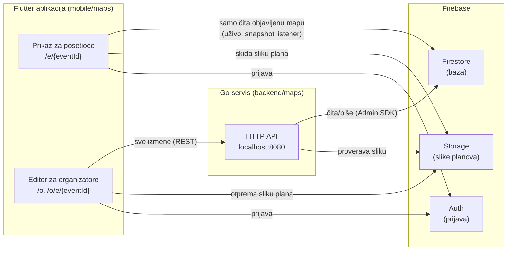

# Mapa prostora: kako sve radi

Objašnjenje za ljude (na srpskom). Tačan ugovor je u [`openapi.yaml`](openapi.yaml) i [`realtime.md`](realtime.md), plan i status faza su u [`PLAN.md`](PLAN.md).

## 1. Šta mapa radi, u jednoj rečenici

Organizator otpremi sliku plana prostora i na njoj nacrta sale, štandove, mesta (toalet, info pult…), QR markere „Vi ste ovde“ i staze. Kada klikne **Objavi**, posetioci koji imaju otvoren link odmah vide novu mapu, mogu da pretražuju i (od faze 5) dobiju put do štanda.

## 2. Tri dela i ko šta radi



| Deo | Folder | Zadatak |
| --- | --- | --- |
| Flutter paket `eho_maps` | `mobile/maps/` | Prikaz za posetioce i editor za organizatore. Aplikacija (`mobile/app/`, Ilij4n) ga samo uključi preko `mapsRoutes()`. |
| Go servis | `backend/maps/` | Jedini koji **piše** u bazu: proverava ko je korisnik, validira podatke, objavljuje mapu. |
| Ugovor | `contracts/maps/` | Dogovor između aplikacije i servisa: koji endpointi postoje i kako izgledaju podaci. |
| Firebase | (emulatori lokalno) | Auth = prijava, Firestore = baza, Storage = slike planova. |

**Zlatno pravilo:** aplikacija nikad ne piše direktno u bazu. Sve izmene idu kroz Go API, a Firestore pravila (`backend/maps/firebase/firestore.rules`) zabranjuju upis iz aplikacije. Čitanje objavljene mape ide direktno iz Firestore-a jer je tako „uživo“ besplatno.

## 3. Podaci: šta je šta

Sve koordinate su **pikseli slike plana** (x udesno, y nadole). Zato mapa radi i bez GPS-a.

| Pojam | Šta je |
| --- | --- |
| **Događaj** (`Event`) | Naziv, datumi, vlasnik (organizator) i `publishedVersion` (0 = nikad objavljeno). |
| **Sprat** (`Floor`) | Jedna slika plana (širina, visina u pikselima). Kasnije (faza 6) i 3 kontrolne tačke koje povezuju piksele sa GPS koordinatama. |
| **Objekat** (`Feature`) | `room` (sala: pravougaonik ili mnogougao), `stand` (štand: tačka ili pravougaonik), `poi` (mesto: ulaz, toalet, info, garderoba, hrana, lift, stepenice), `marker` (QR „Vi ste ovde“). Ima naziv, opis, a štand i kompaniju, kategoriju, sponzorstvo. |
| **Staza** (`Graph`) | Po spratu: **čvorovi** (tačke na hodnicima) i **veze** između njih. Po tome se računa put. Čvorovi sa istim `connector` ključem na različitim spratovima su lift ili stepenice. |
| **Ulaz za rutu** (`entranceNodeId`) | Čvor staze na kome se put do objekta završava (ili, kod QR markera, počinje). Editor ga sam postavi na najbliži čvor. |

### Nacrt i objavljeno

U bazi postoje **dve kopije** mape svakog događaja:

```
events/{eventId}                         ← događaj (naziv, vlasnik, publishedVersion)
events/{eventId}/draft/map/...           ← NACRT: ovo menja organizator, vidi samo on
events/{eventId}/published/map/...       ← OBJAVLJENO: ovo vide posetioci
        ├── floors/{floorId}
        ├── features/{featureId}
        └── graphs/{floorId}
```

Organizator menja samo nacrt. **Objavi** u jednoj transakciji proveri ceo nacrt, prepiše ga u „objavljeno“ i poveća verziju. Posetioci zato nikad ne vide polovičnu izmenu.

## 4. Prijava i ko sme šta

- **Posetilac** se prijavi anonimno, automatski i bez forme. Sme da čita samo objavljene događaje.
- **Organizator** se prijavi email/lozinkom. Sme da menja samo **svoje** događaje: servis to proverava na svakom zahtevu (`ownerUid`).
- Aplikacija šalje Firebase token u zaglavlju `Authorization: Bearer …`. Servis ga proverava (`internal/httpapi/middleware_auth.go`).
- Slike planova u Storage-u: otprema samo vlasnik (najviše 10 MB, PNG/JPEG), a čita svako prijavljen kada je događaj objavljen (`firebase/storage.rules`).

## 5. Tok: organizator pravi mapu

1. `/o`: prijava, pa lista „Moji događaji“, pa **Novi događaj** (`POST /v1/events`).
2. `/o/e/{id}`: editor učita nacrt (`GET /v1/events/{id}` + `GET …/draft`).
3. **Dodaj sprat:** slika ide direktno u Storage (`events/{id}/floors/…`), zatim `POST …/floors`. Servis proveri da slika postoji i pročita joj dimenzije.
4. **Crtanje:**
   - sala, štand, mesto, QR marker: nacrtaš oblik, popuniš formu, pa `POST …/features` (izmena `PATCH`, brisanje `DELETE`);
   - staza: klikovi dodaju i povezuju čvorove. Editor ih skupi i 0,4 s posle poslednjeg klika pošalje ceo graf sprata jednim `PUT …/graph`.
5. **Objavi** (`POST …/publish`). Servis proverava:
   - **greške** (blokiraju objavu): nema spratova, neispravan oblik, ulaz pokazuje na obrisan čvor…;
   - **upozorenja** (ne blokiraju): objekat nije povezan sa stazom ili je na odsečenom delu staze.

   Editor ih prikaže na srpskom, a klik na stavku otvori taj objekat.

Svaki zahtev servis validira (`internal/venue/validate.go`): oblici moraju biti unutar slike, mnogougao ne sme da seče sam sebe, staza najviše 5000 čvorova…

## 6. Tok: posetilac gleda mapu

1. Otvori link `/e/{eventId}` (iz QR koda ili sa ekrana). Opciono `?at={markerId}` znači „stojim kod ovog QR koda“.
2. Aplikacija se anonimno prijavi i „pretplati“ se na `published/map` u Firestore-u.
3. Iscrta plan (`flutter_map`): sliku, sale, štandove, ikonice mesta. Zlatni sponzori su istaknuti.
4. Pretraga ne mari za kvačice („cacak“ nalazi „Čačak Dev“), ima filtere po vrsti i kategoriji, a klik otvara detalje.
5. Kada organizator objavi izmenu, Firestore je sam pošalje svim otvorenim prikazima. Izmereno: **~0,6 s** od klika na „Objavi“.

Link do konkretnog objekta: `/e/{eventId}/stand/{featureId}` (radi za bilo koji objekat, i za salu, npr. iz agende).

## 7. Gde je šta u kodu

| Šta | Fajl |
| --- | --- |
| Rute aplikacije | `mobile/maps/lib/src/routes.dart` |
| Modeli podataka (Dart) | `mobile/maps/lib/src/model/map_models.dart` |
| Čitanje objavljene mape uživo | `mobile/maps/lib/src/data/published_map_repository.dart` |
| Prikaz za posetioce | `mobile/maps/lib/src/viewer/` (`map_viewer_screen.dart`, `venue_map_view.dart`, `search.dart`) |
| Editor | `mobile/maps/lib/src/editor/` (`map_editor_screen.dart`, `editor_canvas.dart`, `feature_form.dart`, `editor_providers.dart`) |
| API klijent (Dart) | `mobile/maps/lib/src/editor/maps_api.dart` |
| Tekstovi sr/en | `mobile/maps/lib/l10n/maps_sr.arb`, `maps_en.arb` |
| HTTP rute servisa | `backend/maps/internal/httpapi/server.go`, `handlers.go` |
| Pravila validacije i objave | `backend/maps/internal/venue/validate.go`, `publish.go` |
| Baza (Firestore) | `backend/maps/internal/store/firestore.go` |
| Demo podaci | `backend/maps/cmd/seed/main.go` (`make seed`) |
| Firebase pravila i emulatori | `backend/maps/firebase/` |

## 8. Pokretanje i testiranje

```bash
mobile/scripts/dev_all.sh                       # emulatori + API + aplikacija u Chrome-u (:5000)
cd backend/maps && make seed                    # demo događaj; ispiše linkove
```

- Posetilac: `http://localhost:5000/e/<eventId>`
- Organizator: `http://localhost:5000/o`, login `organizer@eho.test` / `eho-demo-123` (samo emulator)
- Firebase emulator UI (pregled baze): `http://localhost:4000`
- Testovi: `cd mobile/maps && flutter test`, `cd backend/maps && go test ./...`

Napomena: lokalno, na webu, svako osvežavanje stranice odjavljuje organizatora. To je namerno: inače bi se stara sesija mešala sa emulatorom. Na pravom Firebase projektu toga neće biti.

## 9. Rutiranje (faza 5, u izradi)

Ovaj odeljak se dopunjuje kada faza 5 bude gotova.
