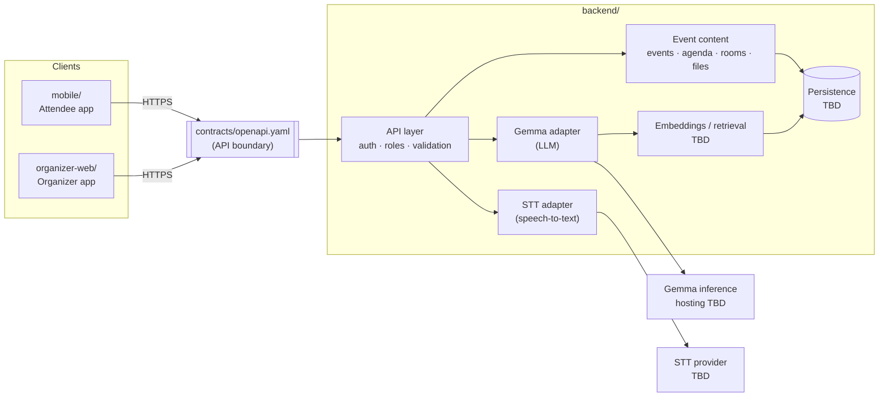

# Eho — Architecture (conceptual)

> **Status: Conceptual.** This shows intended boundaries, not a built system. Hosting, providers, frameworks and databases are **not chosen** (see `DECISIONS.md`). Nothing below is deployed.

## High-level view



Text version:

```
attendee mobile  ─┐
                  ├──► contracts/openapi.yaml ──► backend API
organizer web    ─┘                                   │
                                                      ├─► persistence (TBD)
                                                      ├─► event content (agenda, rooms, files)
                                                      ├─► Gemma adapter ──► Gemma inference (TBD)
                                                      └─► STT adapter   ──► STT provider (TBD)
```

## Boundaries and responsibilities

| Component | Owns | Does not own |
| --- | --- | --- |
| `mobile/` | Attendee UX, local state, rendering fixtures/API data | Business rules, auth decisions, AI calls |
| `organizer-web/` | Organizer UX, upload UI, dashboard views | Role enforcement, file parsing, AI calls |
| `contracts/` | Request/response shapes, shared DTO definitions, fixtures | Implementation |
| `backend/` | API, auth and **role enforcement**, persistence, file handling, all provider adapters | Client UI |

- **Shared DTOs** are defined once, in `contracts/openapi.yaml`. Each module may generate or hand-write its own types from the spec, but the spec is the source of truth.
- **Provider adapters:** Gemma, STT and embeddings each sit behind an interface in the backend. Swapping hosting (local ↔ hosted) or provider must not change the API contract.

## AI processing

- **STT is separate from Gemma.** Speech-to-text turns audio into text (provider TBD). Gemma then works on that text and on event content: answering questions, summarizing, clustering questions, possibly translating or adding context.
- **Gemma is a mandatory part of the final AI functionality.** At least one user-visible feature in the demo must be Gemma-powered. Model size, variant and hosting are TBD.
- **Embeddings / retrieval:** EmbeddingGemma is a candidate for semantic search (talk content, questions, networking profiles). The index/DB is TBD.
- **Model output is untrusted.** The backend validates and constrains it before storing it or returning it. Models never get direct DB access or privileged actions.

## Candidate Google technologies (none decided)

Gemma (required), EmbeddingGemma, Firebase Auth, Firestore, Firebase Hosting, Cloud Run (incl. GPU), Google Cloud Speech-to-Text, Maps Platform. Each must justify itself. Nothing is assumed to be free or already set up.

## Privacy at the architecture level

- Role checks live in the backend, never only in clients.
- Uploaded files are private by default, with type/size/access checks.
- Networking data is only queryable for users who opted in.
- See `DATA_PRIVACY.md`.

## Scalability — hypotheses only

No load testing has been done and there are no metrics. Hypotheses to revisit:

- A stateless API layer could scale horizontally (e.g. on a serverless container platform).
- LLM inference and STT are the likely cost and latency bottlenecks. They might need caching, batching, or precomputing per-session summaries.
- Per-event data partitioning would help with multi-event tenancy.

## Open architecture questions

- Transport for live captions/Q&A (polling, SSE, WebSocket)?
- Where Gemma runs, and what latency is acceptable for the demo?
- One database for content, embeddings and Q&A, or separate stores?
- How organizer uploads are parsed (deterministic parsers, Gemma-assisted extraction, or manual entry)?
